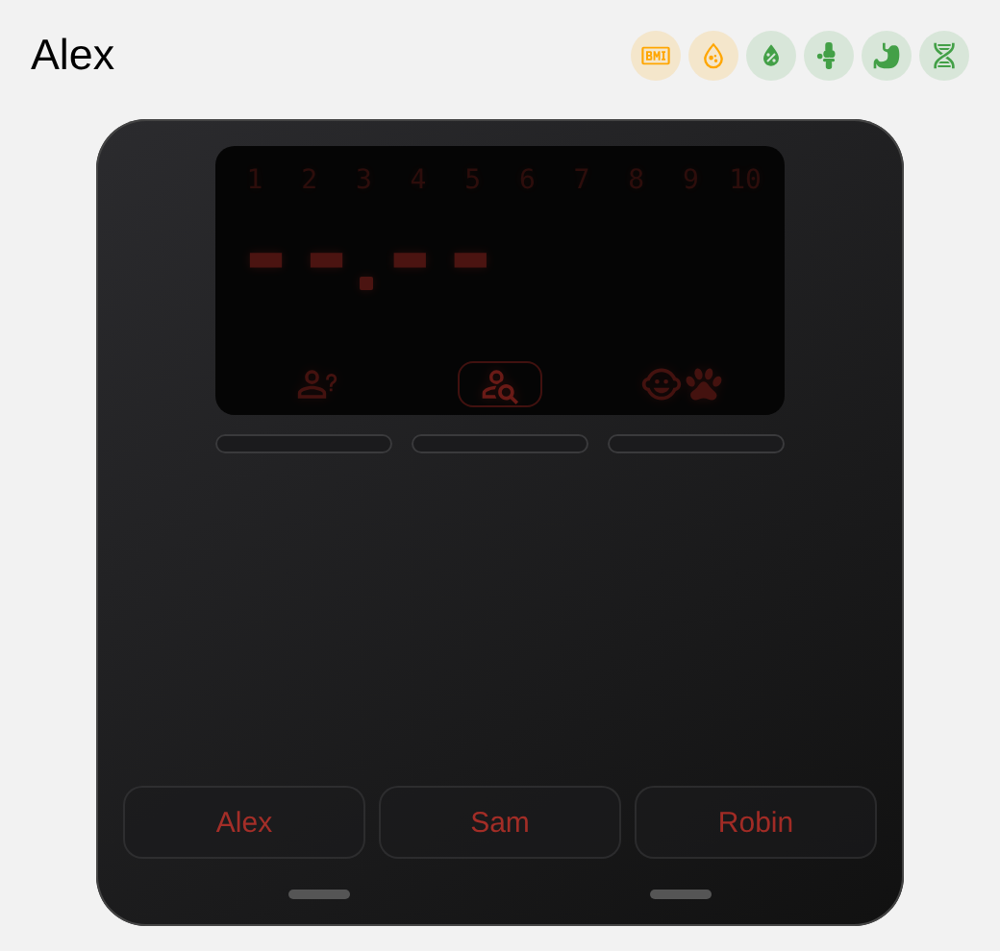
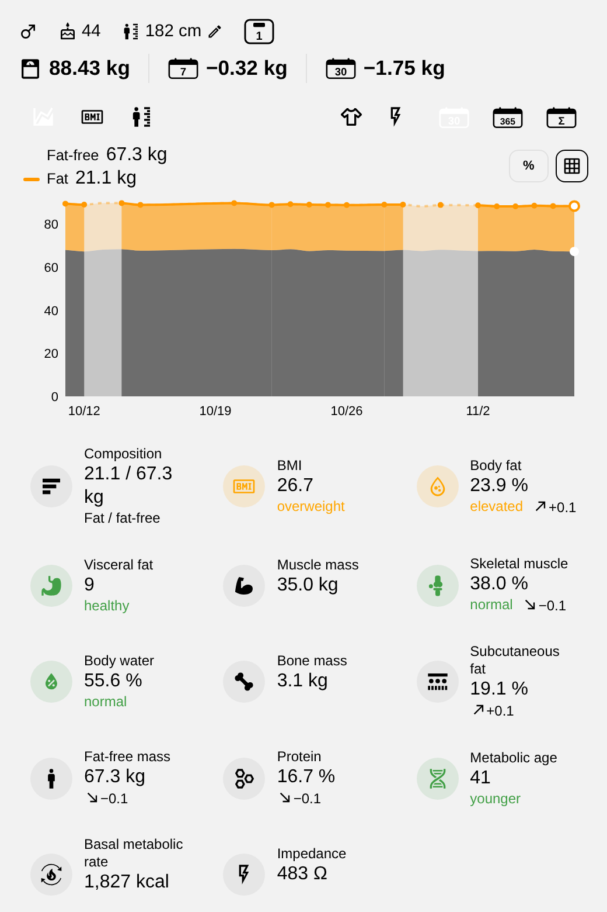
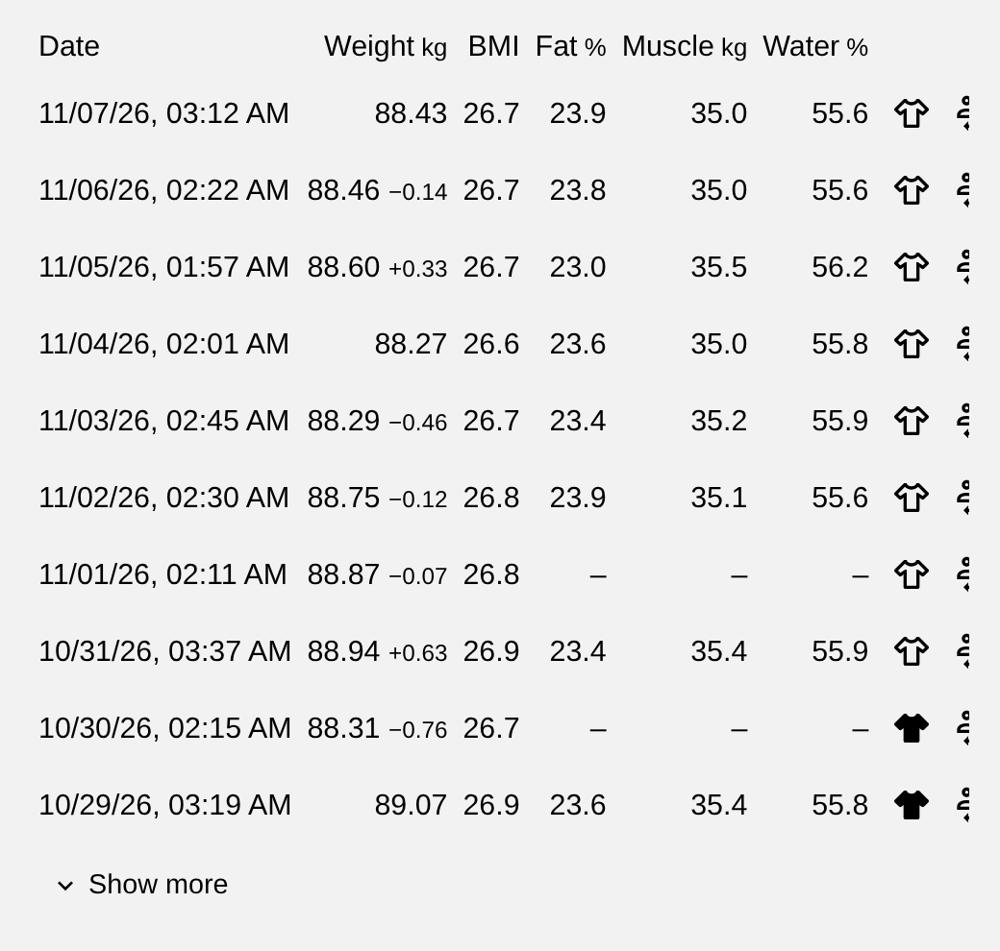
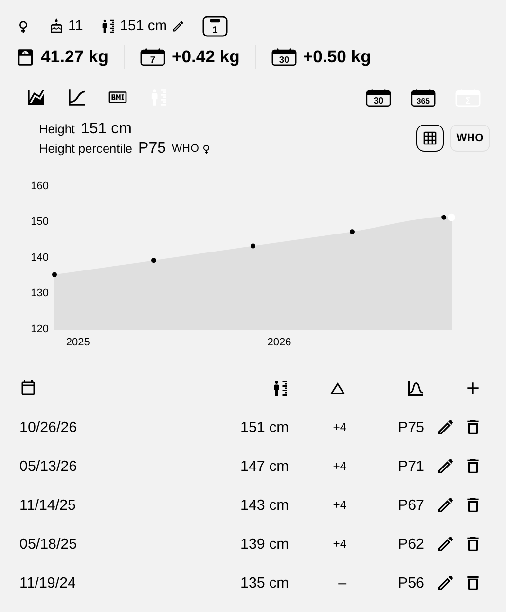

# Body Scale Card

A Home Assistant dashboard card (and dashboard strategy) for smart body scales used by several people: the scale as a device with its display and mode keys, one tab per person with weight, body composition and history charts, children's growth with BMI and height percentiles (WHO and Kromeyer-Hauschild), and a table of entries with assign, move and delete.

**Status:** version `0.1.0`, first public version. It has been used with one scale integration (`renpho_fitness_scale_ble`, family build) and is not yet tested on other setups. Feedback and issues are welcome.

## Screenshots

All screenshots use made-up people and generated values.

## Requirements

The card needs a scale integration that offers the two interfaces S (scale) and H (history), see the specification below. Today the only one is a multi-user family fork of [renpho_fitness_scale_ble](https://github.com/ronnnnnnnnnnnnn/renpho-escs20m) (fork not yet published). A proposal to bring the interfaces into the original integration is open as [issue #17](https://github.com/ronnnnnnnnnnnnn/renpho-escs20m/issues/17). Until it is accepted, the card works only with that fork. **It does not work with the unmodified original integration.**

## It does not know any scale

The card talks to a scale integration only through **two small interfaces with flat records**: **S** (scale: people, heights, open measurements, who weighs next) and **H** (history: entries and lines over time). What a source does not offer (its `capabilities`), the card leaves out. Specification (German): [`docs/SPEZIFIKATION_Schnittstellen_Waage_Verlauf.md`](docs/SPEZIFIKATION_Schnittstellen_Waage_Verlauf.md); formal definition, checkers and in-memory test doubles: `interface/`. Today one integration serves both through Home Assistant services and the attributes of its directory entity; a database program or an HTTP adapter can serve H later without changing the card.

## Install (once published)

HACS: add this repository as a custom repository of type *Dashboard*, then use `type: custom:body-scale-card`. Options and the visual editor: [`docs/CARD.md`](docs/CARD.md). Dashboard strategy: `type: custom:body-scale-card-dashboard`.

If the integration also ships the same card (the family build does for now), both register the same element name; the first one loaded wins and the other is ignored, so nothing breaks.

## Layout

| Path | What |
|---|---|
| `src/*.js` | **the source of the card**, split into modules by topic ([module table](src/README.md)) |
| `dist/body-scale-card.js` | the card as shipped: **one file built from `src/`** (`python tools/build_card.py`), do not edit by hand |
| `dist/body-scale-card.i18n.*.json`, `dist/body-scale-card.growth.*.json` | built copies of the languages and growth tables, **flat next to the card** because HACS installs only the files directly in `dist/` (no subfolders); the card fetches them on demand |
| `translations/*.json` | the source of the texts, one file per language; German and English are built into the card; [how to add a language](translations/README.md) |
| `growth/*.json` | WHO and Kromeyer-Hauschild tables, each with source and licence in its head; [`growth/LICENSES.md`](growth/LICENSES.md) |
| `growth/*.py` | Python reference maths used by the tests (reads the JSON) |
| `interface/` | the two interfaces S (scale) and H (history): records, calls, checkers, in-memory providers, examples ([spec, German](docs/SPEZIFIKATION_Schnittstellen_Waage_Verlauf.md)) |
| `tools/build_card.py` | joins `src/` into `dist/body-scale-card.js` (also embeds German/English and the language list) |
| `tools/check_translations.py` | checks a translation against English |
| `tests/` | `pytest` (needs `node` for the maths comparison) |

Change a table: edit the JSON in `growth/`, run `python tools/build_card.py` (copies it to `dist/body-scale-card.growth.*.json`), then `pytest`. The card loads the tables from these files next to itself only after the user ticked the option in the editor (or pressed "Enable" in a child's chart); without them it works without percentiles.
Change the card: edit the module in `src/`, run `python tools/build_card.py`, then `pytest`.

## Licence

Card code GPL-3.0-or-later ([LICENSE](LICENSE)). The growth tables are separate data under their own terms, including **CC BY-NC-SA** for the WHO table; see [growth/LICENSES.md](growth/LICENSES.md). This is a note, not legal advice.
