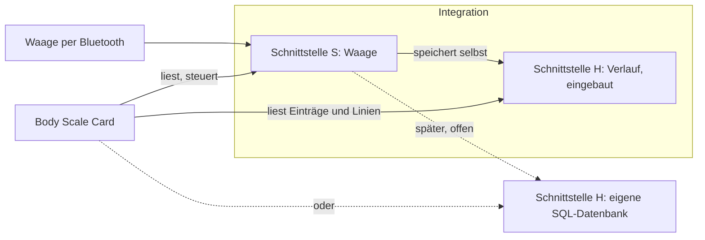

# Spezifikation: zwei Schnittstellen für die Body Scale Card

Stand 08.11.2026 (abends überarbeitet: Kleidung, kleinerer Umfang, `put_entry` und Verlauf-Ziel nur als Gedanke). Stufe 1 (Modul `interface` mit Prüfern und Attrappen) ist umgesetzt. Integration und Karte folgen in Stufe 2 und 3, jeweils nach Okay, als eigene Version.

## 1. Ziel

Die Karte soll mit **zwei voneinander unabhängigen Quellen** sprechen können:

| Schnittstelle | Frage, die sie beantwortet | Wer sie heute bedient | Wer sie später bedienen kann |
|---|---|---|---|
| **S (Waage)** | Wer ist da, wer ist als Nächstes dran, welche Messungen sind offen, wie sind die Profile? | die Bluetooth-Integration | dieselbe oder ein eigenes Programm |
| **H (Verlauf)** | Welche Einträge und welche Linien gibt es über die Zeit? | dieselbe Integration (Recorder und gespeicherte Einträge) | eine SQL-Datenbank als eigenes Programm |

H kennt die Waage nicht. Solange S und H dasselbe Programm sind (heute), speichert die Integration ihre Einträge selbst. Es gibt dann weder ein Ziel zum Auswählen noch einen Aufruf `put_entry`. Beides ist als spätere Erweiterung beschrieben (Abschnitt 11), falls ein zweites Programm dazukommt.



## 2. Regeln für beide Schnittstellen

1. **Flach:** Ein Datensatz hat nur einfache Werte (Text, Zahl, wahr/falsch, leer). Keine Unterobjekte. Eine **Tabelle** ist eine Liste solcher Datensätze. Mehr Verschachtelung gibt es nicht.
2. **SQL-nah:** Jeder Datensatz-Typ entspricht einer Tabelle, jedes Feld einer Spalte.
3. **Zeiten** sind ISO 8601 in UTC (`2026-11-05T20:10:00Z`). Geburtsdatum ist ein reines Datum (`2015-06-20`).
4. **Einheiten:** kg, cm, Ohm, Prozent, kcal. Unbekannt ist `null`, nie `0`.
5. **Namen:** `snake_case`, englisch. IDs sind Text.
6. **Wenige Aufrufe:** S hat 7, H hat 4.
7. **Stabil:** Es kommen nur optionale Felder und Aufrufe dazu. Wer liest, ignoriert Unbekanntes. Umbenennen oder neue Pflichtfelder gibt es nur mit neuer Hauptversion (`scale_interface: 2`).
8. **Fehler** haben einen `code` (`unknown_person`, `unknown_measurement`, `invalid_value`, `not_supported`) und einen Text `message`.
9. **Fähigkeiten** (`capabilities`) sagen, welche optionalen Teile eine Quelle bietet. Die Karte zeigt nur, was angeboten wird.
10. **Unabhängig vom Transport:** Beschrieben sind Aufrufe mit Datensätzen. Die **Anbindung an Home Assistant** (Abschnitt 5) und eine spätere **HTTP/JSON-Anbindung** (Abschnitt 6) tragen dieselben Namen.

## 3. Schnittstelle S (Waage)

### 3.1 Datensätze

`scale` (genau einer):

| Feld | Typ | Pflicht | Beschreibung |
|---|---|---|---|
| `scale_interface` | Zahl | ja | Version der Schnittstelle, heute `1` |
| `capabilities` | Text, durch Komma getrennt | ja | z. B. `next_user,pending,guest,set_entry,set_height` |
| `revision` | Zahl | ja | zählt bei jeder Änderung hoch; die Karte lädt Einträge neu, wenn sie sich ändert |
| `name` | Text | ja | Anzeigename der Waage |
| `manufacturer` | Text | nein | |

`person` (Tabelle `people`):

| Feld | Typ | Pflicht | Beschreibung |
|---|---|---|---|
| `person_id` | Text | ja | |
| `name` | Text | ja | |
| `birthdate` | Datum | nein | |
| `sex` | `male` / `female` | nein | |
| `method` | `standard` / `alternative` | nein | Körperfett-Verfahren |
| `athlete` | wahr/falsch | nein | |
| `private` | wahr/falsch | nein | nur der Besitzer und Admins sehen die Person |
| `owner` | Text | nein | Kennung des Besitzers im System der Quelle (in Home Assistant die Benutzer-ID) |

`height` (Tabelle `heights`): `person_id`, `at` (Zeit), `cm`.

`pending` (Tabelle `pending`, offene Messungen): `measurement_id`, `at`, `weight`, `impedance` (oder leer).
`pending_candidate` (Tabelle `pending_candidates`): `measurement_id`, `person_id`, `suggested` (wahr/falsch).
`guest` (höchstens einer, die letzte nicht gespeicherte Messung): `at`, `weight`, `impedance`.

`next` (genau einer, nur mit `next_user`): `selected` (`auto`, `guest` oder eine `person_id`), `valid_until` (Zeit oder leer), `auto_selected_at` (Zeit oder leer), optional `timeout_minutes` (Standard-Wartezeit einer Vorwahl in Minuten; seit local76).
`next_choice` (Tabelle `next_choices`): `choice_id` (`auto`, `guest` oder `person_id`), `kind` (`auto` / `guest` / `person`), `label`.

### 3.2 Aufrufe

| Aufruf | Eingabe | Ausgabe | Fähigkeit |
|---|---|---|---|
| `get_state` | – | `scale`, `people`, `heights`, `pending`, `pending_candidates`, `guest`, `next`, `next_choices` | – (Pflicht; `people` ist die Pflichttabelle) |
| `set_next_user` | `choice`, optional `minutes` | – | `next_user` |
| `assign_measurement` | `measurement_id`, `person_id`, optional `clothed` | – | `pending` |
| `discard_measurement` | `measurement_id` | – | `pending` |
| `set_entry` | `person_id`, `at`, `weight`, optional `impedance`, optional `clothed` | `entry_id` | `set_entry` |
| `set_height` | `person_id`, `cm`, optional `at` | – | `set_height` |
| `delete_height` | `person_id`, `at` | – | `set_height` |

`set_entry` ist der einzige Aufruf, der rechnet: Aus Gewicht, Impedanz und dem Profil der Person entstehen die Körperwerte; der fertige Eintrag wird gespeichert (heute in der Integration selbst). So bleibt H dumm und einfach.

`set_entry` **ersetzt** einen Eintrag, der zur gleichen Zeit (±1 Sekunde) schon bei dieser Person liegt. So ändert die Karte nachträglich `clothed`: Sie schickt Zeit, Gewicht und Impedanz des vorhandenen Eintrags noch einmal mit und den neuen Wert für `clothed`. „Eintrag einer anderen Person zuordnen“ ist in der Karte `set_entry` bei der Zielperson und danach `delete_entry` bei H für die erste Person. Fehlt `clothed`, gilt `false` (ohne Kleidung).

### 3.3 Beispiel `get_state` (gekürzt, als JSON)

```json
{
  "scale": {"scale_interface": 1, "capabilities": "next_user,pending,guest,set_entry,set_height", "revision": 4711, "name": "Scale"},
  "people": [{"person_id": "jane", "name": "Jane", "birthdate": "1987-03-02", "sex": "female", "method": "standard", "athlete": false, "private": false, "owner": null}],
  "heights": [{"person_id": "jane", "at": "2025-04-02T07:00:00Z", "cm": 168.5}],
  "pending": [{"measurement_id": "m42", "at": "2026-11-08T06:30:00Z", "weight": 71.2, "impedance": 498}],
  "pending_candidates": [{"measurement_id": "m42", "person_id": "jane", "suggested": true}],
  "guest": null,
  "next": {"selected": "auto", "valid_until": null, "auto_selected_at": null},
  "next_choices": [{"choice_id": "auto", "kind": "auto", "label": "Automatic"}, {"choice_id": "guest", "kind": "guest", "label": "Guest"}, {"choice_id": "jane", "kind": "person", "label": "Jane"}]
}
```

## 4. Schnittstelle H (Verlauf)

### 4.1 Datensätze

`history` (genau einer, Teil von `get_info`): `history_interface` (heute `1`), `capabilities` (`entries`, `series`, `variants`, `write`), `name`.

`entry` (Tabelle `entries`, eine Zeile pro Messung, **breit und flach** wie eine SQL-Zeile):

| Feld | Typ | Pflicht |
|---|---|---|
| `entry_id` | Text | ja |
| `person_id` | Text | ja |
| `at` | Zeit | ja |
| `weight` | kg | ja |
| `impedance` | Ohm | nein |
| `method` | `standard` / `alternative` | nein |
| `athlete` | wahr/falsch | nein |
| `replaced` | wahr/falsch | nein |
| `clothed` | wahr/falsch | nein, fehlt = `false` (ohne Kleidung); alte Einträge gelten als ohne |
| `body_mass_index`, `body_fat_percentage`, `body_water_percentage`, `skeletal_muscle_percentage`, `protein_percentage`, `subcutaneous_fat_percentage`, `muscle_mass`, `bone_mass`, `fat_free_mass`, `basal_metabolic_rate`, `visceral_fat`, `metabolic_age` | Zahl | nein, leer = unbekannt |

Das Vokabular der Messgrößen steht im Schnittstellenmodul und darf wachsen.

`entry_variant` (Tabelle `entry_variants`, nur auf Wunsch und nur für den neuesten Eintrag): `entry_id`, `method`, `athlete`, dazu die Spalten von `entry`, die vom Verfahren abhängen (Körperfett, Fettmasse, fettfreie Masse). Damit zeigt die Karte den Vergleich der Verfahren.

`point` (Tabelle `points`): `person_id`, `metric`, `at` (Beginn des Zeitfensters), `value` (Mittelwert), `n` (Anzahl der Einträge).
`series_info` (genau einer in der Antwort von `get_series`): `source` (`statistics` oder `entries`) und `entries_from` (Zeit oder leer: ab wann die Punkte aus einzelnen Einträgen berechnet sind).
`method_change` (Tabelle `method_changes`): `person_id`, `at`, `from_method`, `to_method`, optional `from_athlete`, `to_athlete` (wahr/falsch; seit local76, damit auch der Wechsel der Sportlerkurve markiert wird), für die Markierungen im Diagramm.

### 4.2 Aufrufe

| Aufruf | Eingabe | Ausgabe | Fähigkeit |
|---|---|---|---|
| `get_info` | – | `history` | – (Pflicht) |
| `get_entries` | `person_id`, optional `from`, `to`, `limit` (Standard 100, höchstens 1000), `entry_id`, `variants`, `clothed` (`any`/`yes`/`no`, Standard `any`), `impedance` (`any`/`with`/`without`, Standard `any`) | `entries` (neueste zuerst), `entry_variants` | `entries` |
| `get_series` | `person_id`, `metric`, `from`, `to`, `bucket` (`hour`/`day`/`week`/`month`), optional `tz` (Standard UTC), `clothed`, `impedance` (wie bei `get_entries`) | `points`, `method_changes`, `series_info` | `series` |
| `delete_entry` | `person_id`, `entry_id` | – | `write` |

`get_series` rechnet in der Quelle, nicht in der Karte, und liefert **Zeitfenster-Mittelwerte statt jeder Einzelmessung**. Das erhält die heutige Geschwindigkeit. Die Karte kennt den Recorder nicht mehr.

**Trend und Detail, ein einfaches Prinzip:**
* **Ohne Filter** (`clothed=any`, `impedance=any`) liefert die Quelle die **lange Linie**: In Home Assistant liest die Integration dafür die Langzeitstatistik (`source = statistics`), über alle Jahre. Das ist der Trend, ungefiltert.
* **Mit Filter** liefert sie nur Punkte aus den **gespeicherten Einzeleinträgen** (`source = entries`). `entries_from` sagt, ab wann es Einträge gibt. Weiter zurück gibt es mit Filter keine Punkte, und die Karte weist darauf hin. Der Filter reicht also so weit, wie die Integration Einträge aufbewahrt (Abschnitt 4.2 unten).
* Eine Quelle, die ohnehin nur Einträge kennt (zum Beispiel eine Datenbank), meldet immer `source = entries`; dann gilt der Filter für die ganze Historie.

Grenzen, damit klar ist, was sie bedeuten:
* **Keine Grenze der Tiefe.** Der Zeitraum `from` bis `to` darf beliebig weit zurückreichen, soweit die Quelle Daten hat (in Home Assistant: so lange die Langzeitstatistik aufbewahrt wird, im Normalfall alle Jahre).
* **Grenze der Auflösung.** Eine Antwort enthält höchstens **2000 Punkte** (Person, Messgröße, Zeitraum). Die Karte wählt `bucket` passend zum Zeitraum, zum Beispiel Tag bis ca. 5 Jahre, Woche bis ca. 30 Jahre. Weiter zurück sieht man also Mittelwerte statt Einzelmessungen, nie weniger Zeitraum. Ist die Anfrage zu fein für den Zeitraum, antwortet die Quelle mit `invalid_value` und nennt das kleinste erlaubte Fenster.
* **Zeitfenster.** `at` ist der Beginn des Fensters in UTC. Das erste Fenster darf vor `from` beginnen. Wochen beginnen am Montag. Mit `tz` beginnen Tage, Wochen und Monate um Mitternacht der angegebenen Zeitzone (der Wert bleibt UTC).
* **Pro Person und Messgröße.** Jeder Aufruf gilt für **eine** Person und **eine** Messgröße. Vier Personen mit drei Linien sind zwölf unabhängige Aufrufe; die Karte merkt sich jedes Ergebnis wie heute.
* **Einträge sind etwas anderes als Linien.** `get_entries` liefert Einzelmessungen. Die Integration hält davon pro Person so viele, wie ihre vorhandenen Einstellungen erlauben: `history_retention_days` (Standard 90), `max_history_size` (Standard 100) oder `keep_history_forever`. Das ist die Reichweite der Filter. Eine eigene Datenbank hält beliebig viele und liefert sie mit `from`/`to` in Blöcken von höchstens 1000 (weiterblättern über `to`). Es gibt **keinen zusätzlichen Speicher**: Einträge und `clothed` liegen dort, wo die Integration ihre Einträge heute schon speichert.

### 4.3 Beispiel `get_series`

```json
{"points": [{"person_id": "jane", "metric": "weight", "at": "2026-11-01T00:00:00Z", "value": 70.9, "n": 3}],
 "method_changes": [{"person_id": "jane", "at": "2026-06-14T07:10:00Z", "from_method": "standard", "to_method": "alternative"}]}
```

## 5. Anbindung an Home Assistant

* **S:** Eine Entität `sensor.<waage>_user_directory` (heute vorhanden) trägt als Attribute `scale` (flach), `people`, `heights`, `pending`, `pending_candidates`, `guest`, `next`, `next_choices`. Diese Attribute werden **nicht aufgezeichnet** (wie `pending` heute), damit die Grenze von 16 KB des Recorders nicht greift. Die Aufrufe sind Dienste der Integration, jeweils mit `device_id` der Waage. **Bestehende Dienstnamen bleiben**: `set_next_user`, `assign_measurement`, `discard_measurement`, `set_entry`, `set_height`, `delete_height`.
* **H:** Dienste der Integration mit Antwort: `get_info`, `get_entries` (bleibt, mit Filtern), `get_series` (neu), `delete_entry` (bleibt).
* **Karte:** Optionen `scale:` und `history:` benennen die Quellen (Standard: dieselbe Integration). Sie lädt die Einträge neu, wenn sich `revision` ändert. Die Sensoren für Gewicht, Fett und so weiter bleiben für eigene Dashboards bestehen, die Karte braucht sie nicht mehr.
* **Keine neue Einstellung** in der Integration. Die Reichweite der Filter steuern die vorhandenen Einstellungen für die Aufbewahrung.

## 6. Spätere Anbindung HTTP/JSON (für PC-Programme)

Gleiche Namen, gleiche Datensätze: `GET /state` liefert `get_state`, `GET /entries?person_id=…`, `GET /series?…`, `DELETE /entries/{entry_id}` (später `POST /entries` für `put_entry`), `POST /next_user` und so weiter. Die Karte spricht über einen kleinen Adapter mit Home Assistant (Standard) oder HTTP. Ein Referenz-Verlauf mit SQLite (Tabellen wie oben) und ein Referenz-Waagenprogramm ohne Home Assistant gehören zum Test, nicht zum Lieferumfang.

## 7. Was sich gegenüber heute ändert

| heute (v1) | neu | Anmerkung |
|---|---|---|
| Verzeichnis `users[]` mit `user_id`, `entries_entity`, `metrics{}` | `people`, `heights`, kein `entries_entity`, kein `metrics` | Karte holt Einträge und Linien über H |
| Einträge als Attribut `entries` mit Unterobjekt `values` | flache `entries` ohne Unterobjekt | |
| `methods` dreifach verschachtelt | `entry_variants` flach | |
| `heights` als Paare | Tabelle `heights` | |
| Linien aus Recorder-Statistik in der Karte | `get_series` in der Quelle | schneller Pfad bleibt, nur der Ort wechselt |
| `capabilities` als Liste | Text mit Kommas (flach) | |
| Kleidung | neues optionales Feld `clothed` am Eintrag, Parameter bei `set_entry`/`assign_measurement`, Filter bei `get_entries`/`get_series` | alte Einträge gelten als ohne Kleidung |
| Dienstnamen | bleiben | Felder: `user_id` wird `person_id` in neuen Aufrufen; die alten Felder akzeptiert die Integration weiter |

## 8. Stabilität und alte Daten

* **Nichts an der Speicherung ändert sich:** keine `unique_id`, kein Domain-Name, keine Schlüssel in den Einstellungen. Neue Felder kommen nur dazu und bekommen beim Laden Standardwerte.
* **Kompatibilitätstest vor jeder Auslieferung:** Zwei Schnappschüsse als Testdaten, die Originalversion 0.5.1 und der aktuelle Stand der Familie. Der neue Code muss beide laden, mit denselben Entitäten, `unique_id`s und Werten (Personen, Größenverlauf, Einträge).
* **Schnittstellentests mit Attrappen:** Eine Attrappe für S und eine für H (im Speicher, ohne Home Assistant) prüfen, dass Karte und Prüfer nur die Spezifikation brauchen.
* **Vergleichstest der Linien:** `get_series` liefert dieselben Zahlen wie der bisherige Weg über die Statistik, sonst wird nicht umgestellt. Messung der Antwortzeit bei vier Personen und „alle Jahre“.

## 9. Stufen

1. **Spezifikation und Schnittstellenmodul** (Prüfer für beide Schnittstellen, Attrappen, Beispieldaten). Noch keine Änderung an Integration und Karte. **Erledigt am 08.11.2026:** Modul `interface/` (`common.py`, `scale.py`, `history.py`, `fakes.py`, `examples/`) und 16 Tests.
2. **Integration:** S und H nach dieser Spezifikation: flache Datensätze, `get_series` **vollständig** (Statistik für die lange Linie, Einträge für die gefilterte Detailansicht, Verfahrenswechsel), `clothed` mit Filtern, Kompatibilitätstest. Ohne `put_entry` und ohne Verlauf-Ziel. **Erledigt am 08.11.2026 (local76).**
3. **Karte:** liest nur noch S und H, ohne Recorder. **Erledigt am 08.11.2026 (local76, zusammen mit Stufe 2, ohne alte Form nebenher).** Die Optionen `scale:` und `history:` sind in der Karte noch nicht getrennt: `scale:` (oder `directory:`) nennt die Entität des Verzeichnisses, `history:` folgt mit dem HTTP-Adapter (Stufe 4), bis dahin dieselbe Integration.
4. **Referenz-Verlauf (SQLite) und Adapter in der Karte** für HTTP. Die Oberfläche folgt erst, wenn das PC-Programm wirklich gebaut wird.

**Festgelegt bei der Umsetzung in Home Assistant (local76):**
* `get_state` gibt es zusätzlich als Dienst mit Antwort (dieselben Daten wie die Attribute der Verzeichnis-Entität).
* Fehler: Der Code steht am Anfang der Meldung (`invalid_value: …`), da Home Assistant nur Text transportiert.
* Statistik-Punkte haben kein `n` (die Statistik kennt die Anzahl nicht), Punkte aus Einträgen schon. Die Fenster der Statistik richten sich nach der Zeitzone von Home Assistant; `tz` gilt nur für Punkte aus Einträgen.
* Ohne Filter ergänzt `get_series` vor dem ersten Statistik-Punkt ältere gespeicherte Einträge (wie früher die Karte), `source` bleibt `statistics`.
* `revision` zählt bei jeder Änderung von Einträgen, Personen und Größen; sie startet nach einem Neustart bei der aktuellen Unix-Zeit, steigt also auch darüber hinweg.
* Alte Feldnamen bleiben für immer: `user_id`, `timestamp`, `height_cm`, `timeout_minutes`, `id`, `methods`.

## 10. Entscheidungen (08.11.2026)

1. **Rechnen in S:** `set_entry` rechnet, H speichert fertige Einträge. Entschieden wie vorgeschlagen.
2. **`owner`:** freier Text, die Karte vergleicht ihn über den Adapter mit dem angemeldeten Benutzer.
3. **`put_entry` und Verlauf-Ziel:** nicht Teil der Arbeit. Nur als Gedanke in Abschnitt 11. Die Integration entscheidet später selbst, wie sie an eine getrennte Datenbank schreibt.
4. **Alte Feldnamen** (`user_id` und so weiter) nimmt die Integration dauerhaft weiter an.
5. **Kleidung:** zwei Stufen (`clothed` wahr/falsch). Alte Einträge gelten als ohne Kleidung. Die Filter wirken nur auf gespeicherte Einzeleinträge; die lange Linie bleibt ungefiltert. Kein zusätzlicher Speicher, kein Standardwert pro Person.
6. **`get_series`** wird vollständig in einem Schritt umgesetzt, nicht in Teilen.

## 11. Gedanken für später (nicht Teil der Arbeit)

Nur festgehalten, damit nichts verloren geht. Die Waagen-Integration wird dafür nicht erweitert und nicht gepflegt, die Spezifikation bereitet nur die Trennung vor, damit die Karte unabhängig läuft.

* **Zwei getrennte Programme:** Wenn Waage und Datenbank getrennt laufen, entscheidet die Waagenseite selbst, ob sie intern speichert oder ihre fertigen Einträge an die Datenbank weitergibt, und wie sie das umsetzt (eigene Schnittstelle, direkter Schreibzugriff, Meldungen). Die Karte merkt davon nichts, sie setzt Werte nur über `set_entry`.
* **Falls dafür eine Schnittstelle gewünscht wird:** `put_entry` würde eine fertige Zeile `entry` speichern, ersetzt die mit gleicher `entry_id`, und rechnet nicht. Ein Verlauf-Ziel wäre eine Einstellung des Waagenprogramms, nicht Teil der Aufrufe. Das ist nur ein Vorschlag für den Fall, nicht beschlossen.
* **Standard für Kleidung pro Person**, falls das Setzen im Alltag zu umständlich wird.
* **HTTP/JSON-Anbindung** und Referenz-Datenbank (SQLite), siehe Abschnitt 6.
